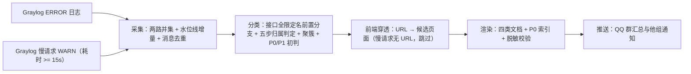

# Graylog 报错与慢请求巡检：从「日志洪水」到「可执行的修正方案」

> 面向传播与分享。想部署看 `接入手册.md`，想验收看 `acceptance-checklist.md`。
> 本文只回答三个问题：它替我做了什么、我该怎么用、结果怎么看。

## 读之前：`<env>` 是什么

文档里的 `<env>` 是**环境名**，执行命令时必须换成具体值。它是 `config\graylog-triage.json` 里 `environments` 的 key，写错会直接 `exit 2`。

当前有两个：

| 名字 | 含义 | 现状 |
|---|---|---|
| `wengyuan-prod` | 翁源生产环境 | **当前默认，采集轮与分析轮两个自动任务都建在这个环境上**（启停以「自动化」面板为准） |
| `87` | 87 环境 | 已停用（无自动任务），历史报告保留在 `docs\agent-reports\graylog-triage\87\` |

一个名字决定五处落地位置（自动任务、水位线、运行日志、报告目录、MCP 连接），完整清单见 5.6。所以换环境**不需要清任何状态**，两个环境的数据也不会互相污染。

**示例**：打开当前环境的今日报告目录

```powershell
$envName = "wengyuan-prod"
$d = "docs\agent-reports\graylog-triage\$envName\" + (Get-Date -Format 'yyyy-MM-dd')
Get-ChildItem $d -Filter "report-summary-*.md" | Sort-Object Name -Descending | Select-Object -First 1 Name, LastWriteTime
```

回看 87 的报告，只把 `$envName` 改成 `"87"`，后面命令一字不动。

> 变量名不要写 `$env`——它是 PowerShell 的环境变量驱动器，赋值会报只读错误，所以全文统一用 `$envName`。

可选值就是 `environments` 下的所有 key。换环境的完整步骤见第 5 章。

---

## 一、它解决什么问题

Graylog 里每天有大量 ERROR，但**滚动日志里看不出归属**。同一条 `feign.RetryableException`，可能是医生站自己的代码写错了，可能是电子病历服务挂了，也可能是护士站应用自己的故障被医生站的线程池顺手记了一笔。

还有一类问题**根本不报错**：接口跑了 15 分钟才返回，日志级别只是 WARN，翻 ERROR 永远翻不到它。用户那边是「点了保存就一直转圈」，这边却一片安静。所以采集是**两路并集**——ERROR 之外，再抓 `LogFilter` 打的慢请求日志，按解析出的耗时毫秒数筛出 ≥ 15 秒的。

人的原始处理方式是：打开 Graylog → 按时间翻 → 看到眼熟的类名 → 猜一下是谁的 → 转发给别人。

这套巡检把这个过程固化成了**由 Qoder 自动任务按固定节奏跑一次的流水线**（采集轮 cron `0,15,30,45 * * * *`，即每 15 分钟；`config.schedule.intervalMinutes` 只在回退到 OS 计划任务时才生效）：

- 不用人盯，增量采集，不漏也不重采
- 每条报错自动判定归属（我们 / 基础设施 / 他组 / 无关 / 待定）；慢请求没有堆栈帧，改按**接口全限定名**判归属
- 自动初判严重度：**P0** = 不可预知的程序异常 + 耗时 ≥ 15 秒的接口，必须出方案；**P1** = 业务正常处理抛出的异常，不强制改代码
- 我们负责的部分，穿透到前端页面，写成「改哪个文件、改成什么、怎么验证」；慢请求写成「耗时花在哪一段、是数据量还是代码缺陷、怎么优化」
- 别组负责的部分，直接生成一份可以原样转发给对方的 md
- 结果落盘 + 汇总推送，人只需要看一份 summary

**一句话**：把「翻日志」变成「读结论」。

---

## 二、它每轮做什么



五个阶段各自返回独立退出码，**任何一环失败都不会污染水位线**：

| 阶段 | 脚本 | 失败后果 |
|---|---|---|
| 采集 | `collect-errors.js` | 水位线不推进，下一轮重采同一窗口。**两路共用一个水位线**，任一路失败整轮不推进；截断时取两路中更早的已取位置，避免把另一路没取完的数据永久甩在水位线之后 |
| 分类 | `classify-owner.js` | 本轮中止，报告不生成 |
| 穿透 | `penetrate-frontend.js` | 仅告警，报告缺界面定位，其余照常 |
| 渲染 | `render-report.js` | 中止。含凭据的内容会被校验闸门拦下不落盘 |
| 推送 | `push-notify.js` | 仅告警，文件照常落盘 |

**为什么穿透失败不阻断**：前端定位是「帮你找入口」的辅助信息，不是结论本身。因为 Python 环境缺失、索引没建这类原因让整轮报告丢掉，等于把辅助当成了主干。

---

## 三、你会得到什么

落盘位置：`docs\agent-reports\graylog-triage\<env>\<yyyy-MM-dd>\`

| 文档 | 给谁看 | 内容 | 生命周期 |
|---|---|---|---|
| `report-summary-HHmm.md` | **你先看这个** | 时间窗、两路采集计数、严重度分布（P0/P1）、归属分布、精度说明、产物清单 | 永久保留 |
| `report-self-HHmm.md` | 我们改代码的人 | P0 优先索引 + 本组簇的严重度与依据、堆栈或耗时样例、前端定位、根因与修正方案 / 耗时归因与优化方案 | 永久保留 |
| `report-infra-HHmm.md` | 一般不看 | 基础设施簇明细 | 只留最新一轮 |
| `notify-<组>-HHmm.md` | **直接转发给对方** | 时间窗、`[P0]`/`[P1]` 标记、traceId、请求接口或慢请求接口全限定名与耗时、调用方、截断堆栈、排查请求 | 只留最新一轮 |

> `report-infra-*` 和 `notify-*` 只保留最新轮次是**故意的**：转发文档的价值在于「这是刚发生的」，留一堆三天前的旧版本只会让接收方困惑。要留历史，另存到别处。

运行日志：插件根目录 `config\logs\triage-<yyyyMMdd>-<env>.log`，每轮各阶段的 `exit=` 与耗时都在里面。多环境各一条日志，不混写。**有自动清理**：每轮末尾按 `output.runLogKeepDays`（当前 14 天）删除超期日志。

---

## 四、每天怎么用

### 姿势 1：什么都不做（推荐，90% 的日子）

Qoder「自动化」面板里的 **医生站 Graylog 报错采集轮（wengyuan-prod）** 按 cron `0,15,30,45 * * * *` 自动跑一轮流水线（每 15 分钟）。**它依赖 Qoder 客户端在线**：客户端退出期间不触发，下次启动后由水位线补齐这段窗口，不会漏采。你每天只需要：

```powershell
# 打开今天的报告目录，按时间倒序看最新的几份 summary
$envName = "wengyuan-prod"   # 要回看旧环境就改成 "87"
$d = "docs\agent-reports\graylog-triage\$envName\" + (Get-Date -Format 'yyyy-MM-dd')
Get-ChildItem $d -Filter "report-summary-*.md" | Sort-Object Name -Descending | Select-Object -First 3 Name, LastWriteTime
```

打开最新那份，看「归属分布」表里**本组是不是 0**。是 0，关掉。

> 变量别写成 `$env`——它是 PowerShell 的环境变量驱动器，赋值会直接报只读错误。

### 姿势 2：手动补跑一轮

```powershell
powershell -NoProfile -ExecutionPolicy Bypass -File .agents\plugins\imedicalxc-doctor-graylog-error-triage\scripts\run-triage.ps1 -Env wengyuan-prod -SkipNotify
```

参数说明：

| 参数 | 用途 |
|---|---|
| `-Env <env>` | 目标环境，不传则用 `defaultEnv`（当前 `wengyuan-prod`） |
| `-SkipNotify` | 跳过推送（调试时必加，避免误发群） |
| `-SkipCollect` | 复用最近一份 `raw-errors-*.json`，只重跑分类之后的阶段 |
| `-Limit 200` | 本轮最多取 200 条，用于快速冒烟 |
| `-NoLock` | 忽略并发锁强制跑（确认没有卡死进程后再用） |

退出码：`0` 正常 / `1` 阶段失败 / `2` 环境不可用（配置或连接）/ `3` 上一轮还在跑，本轮跳过。

### 姿势 3：让 AI 分析本组报错

在会话里说 **「分析本轮本组报错」** 或 **「巡检 Graylog 报错」**。它会读 `report-self-*.md`，**P0 优先**：报错簇进源码定位到文件行号定根因，慢请求簇按接口全限定名确认归属、按 traceId 追全链路分解耗时，判断是数据量本身大还是代码有缺陷。结论（含需要时的严重度改判与依据）写进 `config\pending-queue.json`，再重渲染让方案出现在报告里。

这一步也可以**无人值守**：Qoder「自动化」面板里的 **医生站 Graylog 报错分析轮（wengyuan-prod）** 按 cron `7,37 * * * *` 代跑同一流程，历轮结论累积在同一个自动化会话里便于回看。它只读报告、只写 `pending-queue.json` 与 `analysis-outbox-<HHmm>.md`，**不采集、不外发**——他组通知只整理成待人工转发清单，发不发由你决定。

代跑时它的**取材范围是队列全量候选，不是最新一轮报告**：`pending` 的簇加上「`blocked` 但 `lastSeen` 又前进（有新证据）」的簇，**先按严重度（P0 先于 P1）、再按证据等级与新鲜度排序**，**每轮最多处理 4 条**（实测单簇约 4-5 分钟，一轮 30 分钟的间隔放不下更多）。所以历史积压是**逐轮消化**的，不会一轮清完；证据不足定不了性的簇会标成 `blocked` 暂存，等下次出现新样本再重新纳入候选。想加速就在会话里手动多跑几次「分析本组报错」。

注意它没有独立数据源：Qoder 采集轮被停用、客户端当时不在线、或当日产物被清空时，分析轮只会回报「本轮无采集产物，采集轮未产出，分析跳过」，这是预期行为不是故障。先恢复采集，下一轮分析自然接上。

判断它这一轮有没有真干活，看 `config\pending-queue.json` 是否新增 `analyzed` 条目、报告是否被重渲染、有没有 `analysis-outbox-<HHmm>.md`，**不要只看自动化面板的「成功」状态**——那只代表会话跑完了。分层设计、自动任务身份与运维命令见 `skills\imedicalxc-doctor-graylog-error-triage\references\notification-and-schedule.md`。

**没有这一步，`report-self-*.md` 里的「根因与修正方案」（慢请求簇是「耗时归因与优化方案」）永远是「待分析」**——这是设计决定：脚本不做根因推断，只用代码事实说话。

---

## 五、换环境（停一个、起一个）

自动任务与环境一对一：`医生站 Graylog 报错采集轮（<env>）` 与 `医生站 Graylog 报错分析轮（<env>）`。同一台机器可以同时挂多个环境，也可以只挂一个。换环境就是**停掉旧环境的两个自动任务 + 给新环境建两个自动任务**，配置里不需要删掉旧环境。

只有注册在 `config\graylog-triage.json` 的 `environments` 里的名字才能当 `-Env` / `--env` 用，写错会直接 `exit 2` 并列出可选值（例如写 `wengyuan` 是错的，正确是 `wengyuan-prod`）。

**原则：先冒烟再切换。** 停旧任务到新任务跑完第一轮之间是空窗期。先手动把新环境跑通，空窗只有几十秒；反过来做，万一新环境连不上 Graylog，空窗会变成几小时而你不会察觉。

### 5.1 冒烟新环境（手动跑，不推送、不注册）

```powershell
cd D:\imedicalxc-doctor-all

# 预检：只校验连接与环境配置，不采集、不落盘
node .agents\plugins\imedicalxc-doctor-graylog-error-triage\scripts\collect-errors.js --env wengyuan-prod --check

# 手动跑一轮：限 200 条、跳过推送，确认五个阶段全过
powershell -NoProfile -ExecutionPolicy Bypass -File .agents\plugins\imedicalxc-doctor-graylog-error-triage\scripts\run-triage.ps1 -Env wengyuan-prod -Limit 200 -SkipNotify
```

退出码为 `0` 才算通。出现 `[FAIL]` 先查 `config\logs\triage-<yyyyMMdd>-wengyuan-prod.log`，不要急着往下走。

### 5.2 停掉旧环境

在 Qoder「自动化」面板里对旧环境的两个任务操作，会话内等价动作是 `qoder_cron`：

| 做法 | 动作 | 结果 | 什么时候用 |
|---|---|---|---|
| 停用 | `qoder_cron` `disable`（采集轮 + 分析轮各一次） | 任务留着，只是不触发 | 临时停几天，之后还想恢复 |
| 删除 | `qoder_cron` `remove` | 任务定义整个删除 | 确定不再需要 |

停用后恢复用 `enable`。停之前先确认没有正在跑的一轮：

```powershell
# 存在该锁说明可能正在跑，等本轮结束再停
Test-Path .agents\plugins\imedicalxc-doctor-graylog-error-triage\config\.run-87.lock
```

> 采集轮与分析轮要一起停。只停采集轮，分析轮会继续按 cron 触发，但只会空转回报「本轮无采集产物」。

### 5.3 给新环境建自动任务

两个任务都用 `qoder_cron` 的 `add` 创建（或在面板里新建），关键参数：

| 项 | 采集轮 | 分析轮 |
|---|---|---|
| 名称 | `医生站 Graylog 报错采集轮（<env>）` | `医生站 Graylog 报错分析轮（<env>）` |
| cron | `0,15,30,45 * * * *` | `7,37 * * * *` |
| timeZone | `Asia/Shanghai` | `Asia/Shanghai` |
| 权限 | **Full Access**（`executionAuthorization: true`） | Auto Approval（`false`） |
| outputMode | `merged` | `merged` |
| cwd | `D:\imedicalxc-doctor-all` | `D:\imedicalxc-doctor-all` |
| prompt | 单命令 `run-triage.ps1 -Env <env>` + 退出码协议 + 禁止清单 | 读主 skill 做分析，禁采集、禁外发、禁改调度 |

采集轮**必须 Full Access**：Auto Approval 的权限分类器会把 `powershell -ExecutionPolicy Bypass` 判为任意代码执行直接拦下，实测结果是任务状态显示「成功」但流水线一步没跑。完整 prompt 模板见 `skills\imedicalxc-doctor-graylog-error-triage\references\notification-and-schedule.md`。

建完立刻验证一次，用 `qoder_cron` 的 `run` 触发，然后**只看客观证据**：

```powershell
Get-Item .agents\plugins\imedicalxc-doctor-graylog-error-triage\config\logs\triage-<yyyyMMdd>-wengyuan-prod.log | Select-Object LastWriteTime
Get-ChildItem docs\agent-reports\graylog-triage\wengyuan-prod\<yyyy-MM-dd>\ | Sort-Object LastWriteTime -Descending | Select-Object -First 6 Name, LastWriteTime
```

日志 mtime 推进 + 末尾有本轮 `[SUMMARY]` + 新产物落盘，三项齐了才算通。`lastRunStatus: succeeded` 不算。

### 5.3.1 回退到 OS 计划任务（可选，非默认）

只有需要「Qoder 客户端退出期间也采集」时才走这条路。**启用 OS 任务前必须先 `disable` Qoder 采集轮**，否则两个调度主体重复触发（并发锁会让后来者 exit 3，但白耗一次模型调用）。

```powershell
$sch = ".agents\plugins\imedicalxc-doctor-graylog-error-triage\scripts\install-schedule.ps1"

# 预演：看任务名、触发间隔、运行身份
powershell -NoProfile -ExecutionPolicy Bypass -File $sch -Env wengyuan-prod -DryRun

# 正式注册（同名任务已存在会 exit 3）
powershell -NoProfile -ExecutionPolicy Bypass -File $sch -Env wengyuan-prod

# 验证
Get-ScheduledTaskInfo -TaskName "iMedicalxc-GraylogTriage-wengyuan-prod"
```

OS 路径的节奏只认 `config.schedule.intervalMinutes`（改 cron 不影响它），且需 `executionTimeLimitMinutes < intervalMinutes`。

**`-Force` 不能覆盖同名任务**：它只跳过脚本自己的存在性检查，`Register-ScheduledTask` 仍会抛 `0x800700b7`。要覆盖（例如改了采集间隔）走卸载再注册：

```powershell
powershell -NoProfile -ExecutionPolicy Bypass -File $sch -Env wengyuan-prod -Uninstall
powershell -NoProfile -ExecutionPolicy Bypass -File $sch -Env wengyuan-prod
```

首次触发时间对齐到下一个采集间隔整数倍（间隔 15 分钟时，10:47 注册 → 11:00 首跑）。想立刻验证一次：

```powershell
Start-ScheduledTask -TaskName "iMedicalxc-GraylogTriage-wengyuan-prod"
Get-ScheduledTaskInfo -TaskName "iMedicalxc-GraylogTriage-wengyuan-prod"   # LastTaskResult 应为 0
```

卸载旧环境的 OS 任务（如果之前挂过）：

```powershell
powershell -NoProfile -ExecutionPolicy Bypass -File $sch -Env 87 -Uninstall -DryRun
powershell -NoProfile -ExecutionPolicy Bypass -File $sch -Env 87 -Uninstall
Get-ScheduledTask -TaskName "iMedicalxc-GraylogTriage-87" -ErrorAction SilentlyContinue   # 无输出 = 已删除
```

### 5.4 改默认环境（建议改，最容易忘）

`config\graylog-triage.json` 的 `defaultEnv` 决定「脚本不带 `--env` 时跑哪个环境」。自动任务的 prompt 里是显式传 `-Env` 的，不受它影响，但会话侧手动跑、AI 读报告时会用到。

```json
"defaultEnv": "wengyuan-prod",
```

不改的下场：采集轮在跑 wengyuan，你手动说「分析本轮本组报错」，读到的却是 87 的旧报告。

### 5.5 回滚

把新环境的两个自动任务 `disable`（或 `remove`），再把旧环境的两个 `enable`（没建过就按 5.3 新建）。水位线各自独立，回滚后旧环境会从它自己的 cursor 继续，不会重采。

### 5.6 环境之间互不影响

| 资源 | 是否共用 | 位置（以 `wengyuan-prod` 为例） |
|---|---|---|
| Qoder 自动任务 | 不共用 | `医生站 Graylog 报错采集轮（wengyuan-prod）` + `…分析轮（wengyuan-prod）`（回退到 OS 调度时为 `iMedicalxc-GraylogTriage-wengyuan-prod`） |
| 水位线 + 去重表 | 不共用 | `config\graylog-triage-state-wengyuan-prod.json` |
| 并发锁 | 不共用 | `config\.run-wengyuan-prod.lock` |
| 运行日志 | 不共用 | `config\logs\triage-<yyyyMMdd>-wengyuan-prod.log` |
| 报告产物 | 不共用 | `docs\agent-reports\graylog-triage\wengyuan-prod\` |
| MCP 连接 | 不共用 | `mcp.json` 的 `graylog-wengyuan-prod` 条目 |

所以换环境**不需要清任何状态**，不会重采也不会漏采。`87` 的历史报告原地保留，回看直接进 `docs\agent-reports\graylog-triage\87\`。

---

## 六、报告怎么读

### 6.1 summary 逐行拆解

以 2026-11-20 19:25 这一轮的真实文件为例（`wengyuan-prod`）。**这一轮采集时阈值还是 60s**，所以下面原文里的 `>= 60s` 是历史值，不是当前配置；阈值已下调为 15s，新轮次会打印 `>= 15s`。引用保留原文，便于和磁盘上的产物对照：

```
# Graylog 报错与慢请求巡检（wengyuan-prod 环境）

- 运行 ID：wengyuan-prod-20261120-192527              ← 轮次唯一标识，排查问题时拿它定位日志
- 采集窗口：2026-11-20T10:28:05.793Z → 11:25:27.421Z（增量，UTC，本地时间 +8）
- 报错查询：`level:3`                                ← 第一路：只抓 ERROR
- 慢请求查询：`full_message:"接口响应超过"`，阈值 >= 60s（按解析出的耗时毫秒数判定，框架文案分档最高只到 15秒）
- 慢请求命中：达标 0 条 / 抓取 0 条（窗口内共 0 条）   ← 第二路：这一轮窗口内没有慢请求，属正常
- 簇 31 个，覆盖日志 186 条（报错 186 / 慢请求 0）    ← 186 条日志归成 31 个「同一个问题」
- 前端穿透：启发式（候选页面级，命中 0/14 个本组簇），目录 256 页
- 精度说明：codegraph 索引已构建，但穿透脚本尚未启用按钮级分支，当前为候选页面级
```

**窗口是 UTC**，比本地时间早 8 小时；文件名里的 `1925` 才是本地时间。看到 `10:28 → 11:25` 不要以为是上午的旧数据，那就是本地 18:28 → 19:25。

**「簇」是关键概念**：不是 186 个问题，而是 31 个。聚簇口径分两种：

- 报错：`errorHash = sha1(异常类 | 首个本组堆栈帧 | 消息模板)[:16]`
- 慢请求：`errorHash = sha1('slow|' + 接口全限定名)[:16]`，**不含耗时**

两者都不含 traceId，所以同一个 bug 打了一千次也只算一个簇；同一个接口反复慢也只算一个簇，耗时取最大值与平均值，次数累加。

紧接着是**严重度分布**，它决定你先看哪一段：

```
| 严重度 | 簇数 | 处理要求 |
| P0 · 不可预知程序异常 | 25 | 必须给出代码修改或报错处理方案 |
| P0 · 慢请求（>= 60s） | 0 | 必须分析耗时原因：数据量正常长耗时 或 代码缺陷 |
| P1 · 业务正常处理抛出 | 6 | 确认业务语义与提示文案，不强制改代码 |
```

这是**脚本初判**，信号是业务拦截器 logger、消息首行「业务异常(」、业务异常类名。分析轮可以改判（写 `analysis.severity` + `severityReason`），改判后这张表与明细同步生效。初判偏保守：配置缺失、数据校验类的 ERROR 也会先落 P0，由分析轮降级。

### 6.2 归属分布 —— 按这张表决定动作

```
| 归属 | 簇数 | 处理 |
| 本组（有本组堆栈帧） | 4 | 出根因与修正方案 |
| 本组（仅应用名推断） | 10 | 列证据但不定性，需交叉基础设施/他组簇 |
| 本组（慢请求） | 0 | 分析耗时原因，出优化方案 |
| 基础设施 | 9 | 仅汇总，不单独推送 |
| 他组 | 4（1 组） | 生成转发文档并推送 |
| 无关 | 3 | 他组应用自身故障，本组未参与，仅统计不推送 |
| 待定 | 1 | 不推送，进人工确认队列 |
```

本组拆成三行是**故意的**：三行的证据强度完全不同，能下的结论也不同。恒等式 `有堆栈帧 + 仅应用名 + 慢请求 = 本组总数`（4 + 10 + 0 = 14）。注意慢请求那一行按类型计数，一个没有本组堆栈帧的慢请求簇算在「慢请求」里，不会重复算进「仅应用名」。

| 看到什么 | 你该做什么 |
|---|---|
| 本组三行都是 0 | 结束。今天医生站没有需要改的报错，也没有超阈值慢接口 |
| P0 ≥ 1 | 优先处理。说「分析本轮本组报错」，让我进源码定根因或做耗时归因，**P0 必须拿到方案** |
| 只有 P1 | 不急。确认业务语义与提示文案是否合理，不强制改代码 |
| 本组（仅应用名推断）≥ 1 | **不能直接定性为本组代码缺陷**。这些簇没有本组堆栈帧，要交叉同轮基础设施/他组簇与 traceId 才能判 |
| 本组（慢请求）≥ 1 | 按接口全限定名确认归属，再按 traceId 追全链路分解各阶段耗时，区分「数据量本身大」与「代码有缺陷」 |
| 待定 ≥ 1 | 说「校准归属分类」，拿 `--calibrate` 的观测证据补配置。**不要凭「看起来像医生的」就往 self 里塞** |
| 有 `notify-*` | 打开确认无 IP / 主机名 / 凭据后，转发给对应产品组 |
| 无关很多 | 正常。别人的应用在报错，医生站只是顺手记了一笔 |

**「无关」和「他组」的区别**，这是最容易混的一对：

- **他组**：医生站调对方接口失败（`feign.RetryableException`），或同一个 traceId 里对方应用自己也报错 → **医生站参与了，需要通知对方**
- **无关**：对方应用自己的故障，traceId 里找不到医生站任何一帧 → **与本组无关，只做统计**

区分靠 traceId 和堆栈帧，不靠 app_name。因为医生站和基础设施共用 `his-mediway-server` 这个应用名，只看 app_name 会把基础设施的报错算成我们的。

### 6.3 精度说明 —— 四种降级原因，含义完全不同

summary 里的「精度说明」行会告诉你前端定位为什么停在启发式：

| 出现的话 | 真实含义 | 要不要处理 |
|---|---|---|
| `未构建 codegraph 前端索引` | 索引目录不存在，确实没建 | 想升级就建（约 50 秒，需授权） |
| `本轮无本组或待定簇，未产生界面定位需求` | **本轮没有任何需要定位的东西** | 不用。这是正确结果，不是缺陷 |
| `本组簇均无浏览器发起的请求` | 全是服务间调用或后台线程，浏览器本来就不会发这种请求 | 不用。没有界面可定位 |
| `索引已构建，但穿透脚本尚未启用按钮级分支` | 唯一的技术债 | 已知，等真实样本再补 |

**早期这四种情况都被含糊地写成「索引未构建」**，导致「明明建了索引为什么还说没建」的困惑。现在四种分开说，是因为自动化报告的措辞必须反映客观事实——错误的归因比没有归因更浪费时间。

---

## 七、一次真实的完整走查

2026-11-19 21:00 轮，本组 1 簇。看它是怎么变成一条可执行指令的。

> 该轮取自切换前的 `87` 环境，仅作样例；换环境后报告结构与读法完全一致。

### 第一步：summary 告诉你「本组 1 簇」

上面那张归属分布表就是。到这里你只需要决定一件事：要不要看下去。

### 第二步：`report-self-2100.md` 给出证据

```
## 1. `com.mediway.his.api.exception.HisBusinessException` × 5

| errorHash | `d2e49064e4090797` |
| 归属 | self / opreg |
| 判定依据 | app-name（high） |
| 首次 / 末次 | 12:38:22 → 12:58:23 |
```

关键信息：

- **`errorHash`**：以后想找「上次报这个」就搜这串，比搜异常类准
- **`self / opreg`**：落在 opreg 模块，源码在 `src/backend/opreg-mediway-boot/`
- **堆栈摘要保留 35 行**，且**优先保留 `Caused by` 和业务帧**，中间用 `...` 标记省略

这里堆栈里的业务帧直接给出了整条调用链：

```
HisBusinessException: 调用【门诊诊疗】服务的停止医嘱接口异常:计费判断停医嘱失败：医嘱编号=147900已经结算
	at UpdateOrderStatusClientAbstract.stopMulti(UpdateOrderStatusClientAbstract.java:35)
	at DealApptionmentAbstract.stopOrdMulti(DealApptionmentAbstract.java:353)
	at DealApptionmentAbstract.cancelAppointmentBiz(DealApptionmentAbstract.java:221)
```

### 第三步：根因与修正方案（会话侧分析后回填）

```text
**根因**
调用链：opreg 取消预约（cancelAppointmentBiz:221 → stopOrdMulti:353）
→ Feign UpdateOrderStatusClient.stopMulti（:35）
→ opcare OpCareUpdateOrderStatusController.stopMulti
→ OpCareCheckOrdItemStopAbstract:97-118 调 opArOrdItemBLH.verifyStop 做计费校验
→ 计费返回「医嘱编号=147900已经结算」→ 包装成 stop1003 → opreg 再包装成 rpcException

根因是业务状态冲突：取消预约要停止关联医嘱，但该医嘱已收费结算，计费规则拒绝停止已结算医嘱。

注意 OpCareCheckOrdItemStopAbstract:99 的 if (!OperOrdItemStatusSourceEnum.AR.equals(operSource))
—— 只有计费/退费来源才跳过该校验，opreg 取消预约走医生站来源，因此必然被拦。

**修正方案**
1. 业务口径（优先）：取消预约前先判断关联医嘱是否已结算，
   已结算则引导走「退费 → 再取消预约」，前端给明确提示而非抛服务异常
2. 代码口径：UpdateOrderStatusClientAbstract.stopMulti 捕获 HisBusinessException 时
   区分「业务校验失败」（保留返回码与原文）与「服务不可达」，
   不要把业务提示统一包装成「调用服务异常」，否则真实原因被掩盖
3. 不建议把 operSource 改成 AR 绕过校验——会造成费用与医嘱状态不一致
```

这套结论有三个特点，也是这套工具想传达的方法论：

1. **根因穿透了三层包装**，落到「医嘱已结算」这个业务事实上，没有停在「调用门诊诊疗服务异常」——**调用方包装异常不是根因**
2. **给了三个方案，并明确否掉了最省事那个**：改 `operSource` 绕过校验能立刻消掉报错，但会造成费用与医嘱状态不一致。**能消掉日志的方案不等于正确的方案**
3. **验证方式是重放**：同一条已结算医嘱重放取消预约，再用未结算医嘱验证正常流程没被破坏

### 第四步：他组那 3 簇，直接转发

`notify-电子病历-2100.md`，3 簇 44 次。转发前扫一眼有没有 IP / 主机名 / 凭据——渲染阶段已经做了一次闸门拦截，含 `authentication=`、Basic 串、IP 的内容会被拦下不落盘。

---

## 八、能力边界

明确不做什么，比宣传做什么更重要。

| 边界 | 说明 |
|---|---|
| **抓 ERROR + 慢请求两路** | ERROR 走 `level:3`；慢请求走 `full_message:"接口响应超过"` 再按耗时 ≥ 15s 筛。其余 WARN / INFO 不看 |
| **不做根因推断** | 脚本只输出证据与严重度初判，根因必须由人（或会话侧 AI）进源码确认 |
| **慢请求没有堆栈帧** | `LogFilter` 只打接口名与耗时。归属靠接口全限定名，耗时归因靠 traceId 追全链路，**不能凭异常类猜代码位置** |
| **慢请求没有前端定位** | 日志里不含请求 URL，穿透层一律计入 `no-http-request` 跳过。建前端索引也不会改善 |
| **严重度初判偏保守** | 配置缺失、数据校验类 ERROR 会先落 P0，需分析轮按业务语义改判为 P1；改判必须写 `severityReason` |
| **前端定位是候选页面级** | `effectiveMode` 硬编码为 `heuristic`，给的是「可能由此页面发起」，不是「必然」 |
| **去重表只保 6 小时** | `state.dedupeTtlHours` 当前 6，超 `dedupeMaxEntries`（80000）按时间淘汰最旧。不是 30 天 |
| **不猜归属** | 判不出来就进「待定」，不进 self 白名单。宁可漏，不可错 |
| **推送未接通** | QQ 机器人网关层 403，需要网络白名单。当前靠读文件 + 手工转发 |

### 两个已知的具体短板

**1. 同一根因可能分裂成多个簇。** 21:00 轮里 3 个他组簇的 `Caused by` 都是 `UnknownHostException: emr-mediway-server`，但消息模板分别是：

```text
线程池任务执行异常
线程池任务执行异常：emr-mediway-server executing POST ...
线程池任务执行异常：emr-mediway-server: Name or service not known executing POST ...
```

因为 errorHash 含「消息模板」，模板不同就不同簇。**看的时候要交叉「涉及 URL」和 `Caused by` 行**，别当成三个独立问题。

**2. 前端索引不等于按钮级定位。** 索引里有 1686 个 Controller、11563 个 URL、6015 个页面、38350 条链路，但穿透脚本目前只走到「候选页面」，没接 codegraph 分支。`--check` 一跑就会发现 `matched` 经常是 0——这可能是「本轮确实没有浏览器请求」，也可能是「有请求但路径不在登记的 256 页清单里」。报告会区分这两种，但不会替你判断第三种情况。

---

## 九、背后的三个设计取舍

这三条是这套工具能长期跑下去的原因，也是分享时最值得说的部分。

### 1. 采集与判定分离，判定与叙述分离

```
采集 → raw-errors-*.json   只负责「原样拿到」，不解析语义
分类 → classified-*.json   只负责「谁的问题」，不生成文案
渲染 → report-*.md         只负责「怎么说」，不重新判定
```

好处是每一层都能独立重跑。补了归属配置只需要重跑分类；改了报告措辞只需要重跑渲染（`--classified <已有文件>`）。**不用为一个文案改动去重新连 Graylog 拉一遍数据。**

### 2. 宁可少出报告，不让带敏感内容落盘

渲染阶段有双层校验：结构校验 + 脱敏校验。含主机名、IP、令牌、`authentication=` 的内容会被拦进 `blocked` 列表，**写完其他文件后 `exit 1`**。

这是有意选择的失败方向：一份缺了几个字段的报告可以人工补，一份把内网地址和 token 写进 git 的报告收不回来。

### 3. 待定就是待定，不猜

判不出归属的簇进「待定」桶，不进 self 白名单、不推送、进人工确认队列。规则是：**先有 `--calibrate` 的观测证据，再补配置。**

反例是最容易犯的错：看到一个 `mrdia` 开头的包觉得「像病历，算我们的吧」，塞进 self —— 结果病历组的 bug 被算到医生站头上，问责时说不清。

---

## 十、关键数字

单轮巡检：**约 6-7 秒**，五阶段全过。这是**加入慢请求这一路之前**的实测值；现在采集多一次查询，耗时会略增，含慢请求命中的整轮耗时尚未实测。

慢请求（24 小时只读探针实测，`wengyuan-prod`，**当时阈值为 60s**）：

| 指标 | 数值 |
|---|---|
| 选择器命中 | 244 条 |
| 解析失败 | 0 条 |
| 未达 60s 阈值被丢弃 | 28 条 |
| 达标（≥ 60s） | 216 条 |
| 涉及接口 | 3 个 |
| 最长单次耗时 | 2101.2 秒（约 35 分钟，平均 676.6 秒 × 132 次） |
| 次长 | 929.5 秒（平均 452.8 秒 × 83 次） |
| 日志文案分档 | **216 条全部写着「超过15秒」** |

最后一行说明**文案档位不能当耗时用**：一次 35 分钟的调用和一次 16 秒的调用，文案一模一样都是「超过15秒」。所以判定一律走解析出的毫秒数，`tier` 只作展示。阈值曾设 60s，那时靠文案选会漏掉全部长耗时请求；现在阈值 15s 与最高档同档，文案与达标集合大致重合，但「超过」与「>=」语义不同、档位阶梯也不透明，仍然不能改用文案筛选。

**阈值下调到 15s 后这组数字怎么变**：选择器命中与解析失败不变（244 / 0），达标集合只能从那 28 条被丢弃的日志里增加，所以该 24h 窗口最多 244 条达标（+28，约 +13%），涉及的接口数也可能多于表中的 3 个。这 28 条的耗时分布没有单独留存，准确增量要等下一个含慢请求的采集轮实测。

> **验证口径要说清**：上面这组数字来自只读探针（查询 + 解析 + 归属判定），**不是**一轮真实采集的产物。截至本次改动，还没有任何一轮真实采集窗口里出现过慢请求命中，所以「采集 → 分类 → 渲染」在真实慢请求数据上的端到端表现只用合成数据验证过，要等下一个含慢请求的采集轮才能确认。

前端索引（可选，一次性构建）：

| 指标 | 数值 |
|---|---|
| 构建耗时 | 50.9 秒 |
| 产物体积 | 342 MB |
| Controller | 1686 个 |
| URL 端点 | 11563 个 |
| 前端页面 | 6015 个 |
| 页面元素 | 178621 个 |
| JS 文件 | 9071 个 |
| 调用链路 | 38350 条 |
| URL 命中率 | 3581 / 10661 = 33.6% |

33.6% 是健康值：剩下的 2/3 是外部服务接口、动态拼接路径、框架内部端点，本来就不该有前端页面。

磁盘占用：`raw-errors-*.json` 是主要消耗，约 300-500 MB/天，保留 3 天后稳定在 1.5 GB 以内。

---

## 十一、最短路径

```text
每天早上（或想起来的时候）
  ↓
打开最新的 report-summary-*.md
  ↓
「严重度分布」里 P0 是不是 0？
  ├─ 是 → 看「归属分布」本组三行是不是也 0
  │        ├─ 是 → 关掉。今天的活干完了
  │        └─ 否 → 只剩 P1，确认业务语义即可，不强制改代码
  └─ 否 → 说「分析本轮本组报错」
            ↓
        P0 报错：根因 + 改法 + 验证方式
        P0 慢请求：耗时花在哪段 + 数据量还是缺陷 + 优化方案
            ↓
        有 notify-* 就转发，没有就结束
```

就这些。它自动在跑，你只需要先看一个数字：P0 有几簇。