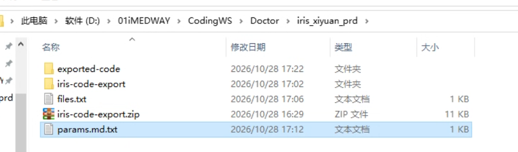

# IRIS 内网源码导出与离线交付：人工操作说明

把 ZIP 带到现场电脑或远程电脑，解压即可使用。需要 Windows PowerShell 5.1 或 Windows 上的 PowerShell 7，不需要 AI、框架技能、Node.js、Git 或 MCP。

**以下操作全部在实际能访问 IRIS 的那台电脑执行。** 如果正在远程桌面里操作，就在远程桌面的 PowerShell 和浏览器中检查，不能用自己本机的连通性替代。

图形便携包 `iris-code-export-gui.zip` 完整解压后双击 `IRISSourceExporter.exe`，无需手工创建 TXT 或批次目录；详见同包 `GUI.md`。它提供配置保存、粘贴清单、版本选择和 1/4/10 会话速度，连续批次复用会话，默认安全单会话。CLI 包不含图形入口，以下命令行方式继续可用。

## 一、文件这样放，在项目目录执行

推荐采用下面的摆放方式。`项目目录` 是你自己选的工作目录，名字没有要求：

```text
项目目录\
├─ iris-code-export.zip        带来的压缩包
├─ iris-code-export\           解压后的工具目录
│  ├─ README.md
│  ├─ export-iris-code.ps1
│  ├─ export-version-baseline.ps1  按版本选择范围后复用导出脚本
│  ├─ source-delivery.ps1     离线保存原始基线与生成还回文件
│  ├─ files.example.txt
│  ├─ catalogs\              包内生成的版本清单和来源摘要
│  └─ images\project-layout-example.png
├─ files.txt                   自己编写的导出清单
└─ exported-code\              执行导出后生成，第一次执行前应不存在
```

导出完成后的实际目录示例：



图中的 params.md.txt 是现场自建的操作说明，不是脚本必需文件；ZIP 自带说明位于工具目录内的 README.md。图片展示目录层次，实际脚本列表以本文目录树为准；是否全部成功仍以终端的 complete 和文件数量为准。

**PowerShell 停留在项目目录，不是工具子目录。** 打开项目目录，点击资源管理器地址栏，输入 `powershell` 后回车。若解压后又套了一层文件夹，先整理到图中的结构，确保脚本位于 `iris-code-export\export-iris-code.ps1`。

在资源管理器“查看”中打开“文件扩展名”，确认清单实际叫 `files.txt`，不是 `files.txt.txt`；脚本实际是 `.ps1`，不是 `.ps1.txt`。`README.md.txt` 仍可阅读，但建议说明文件保留 `.md` 名称。

文中的每个 PowerShell 代码块都是一整行。**完整复制一行、粘贴、按回车**；窗口自动换行不影响执行。若出现连续的 `>>`，表示命令还未补全，先按 Ctrl+C 回到 `PS …>`，再重新复制整行，不要倒序粘贴多行代码。

## 二、准备 files.txt

已有清单就直接用记事本编辑，不必重新复制示例。下面一行只会在没有 files.txt 时创建示例副本，不覆盖已有清单：

```powershell
if (-not (Test-Path -LiteralPath .\files.txt)) { Copy-Item -LiteralPath .\iris-code-export\files.example.txt -Destination .\files.txt }; notepad .\files.txt
```

保存为 **UTF-8**，每行一个准确对象。后端写对象全名和扩展名，前端写以 `/` 开头的完整 Web 虚拟路径：

```text
# 后端示例
DHCDoc.Util.RegisteredObject.cls

# 前端示例：前缀属于相应项目，并非脚本固定值
/imedical/web/scripts/udhcfavitem.edit.newshow.js
/imedical/web/csp/chemo.aform.main.csp
```

其它现场必须换成实际存在的对象名和路径。`/imedical/web` 不是固定前缀；其它说明里的 `webapp` 也只是占位符。脚本不会自动补 Web 前缀，不接受本地磁盘路径来代替服务器虚拟路径。

- 后端支持 `.cls/.mac/.inc/.int`；不写磁盘目录，必须带扩展名。
- 前端支持 `.csp/.csr/.js/.css/.html/.htm`；必须以 `/` 开头。
- 允许空行、整行 `#` 注释和 UTF-8 BOM；不支持行尾注释。
- 不接受通配符、整个目录、缺扩展名、相对前端路径或图片。重复对象、目录穿越、Windows 保留文件名和落盘冲突会停止。

## 三、先检查清单，再导出

在项目目录执行，先检查格式与路径映射：

```powershell
powershell.exe -NoProfile -ExecutionPolicy Bypass -File .\iris-code-export\export-iris-code.ps1 -ListFile .\files.txt -OutputDirectory .\exported-code -PlanOnly
```

看到 `total` 和逐项清单，表示本地检查通过。此时 `status: pending`、`sha256: null`、`bytes: 0` 都正常：**PlanOnly 没有连接服务器，也没有导出文件或创建输出目录。** total 应与你清单里实际对象数量一致。

确认后执行正式导出，只去掉末尾的 `-PlanOnly`：

```powershell
powershell.exe -NoProfile -ExecutionPolicy Bypass -File .\iris-code-export\export-iris-code.ps1 -ListFile .\files.txt -OutputDirectory .\exported-code
```

`-ExecutionPolicy Bypass` 只作用于这次新启动的进程，不修改系统执行策略。使用前确认脚本来源并遵守现场要求。

程序依次提示：

1. **Atelier 根 URL**：输入现场实际地址，格式为 `https://<服务器或域名>:<端口>/api/atelier/`，可带网关前缀；不要在末尾追加 namespace，也不要照抄其它环境的地址。
2. **Namespace**：填写要读取对象所在的 namespace，单独输入。
3. **账号与密码**：在凭据输入框/提示中填写具备相应读取权限的现场账号，不把密码写入脚本、清单或命令明文。

<!-- local-atelier-example -->

HTTPS 使用 Windows 的证书信任，脚本不绕过证书校验；请求直接访问输入地址，不使用系统代理，也不跟随重定向。

清单较大时，可在第一次正式命令末尾加 `-MaxFilesPerRun 1`，先确认一个文件能落盘，再另开 PowerShell 用下面的恢复命令继续。

## 四、失败或只导出一部分，用 Resume

正式导出开始后，即使一个文件都没取到，也可能已经生成 `exported-code` 和恢复记录。**保留目录，在原命令末尾加 `-Resume`：**

```powershell
powershell.exe -NoProfile -ExecutionPolicy Bypass -File .\iris-code-export\export-iris-code.ps1 -ListFile .\files.txt -OutputDirectory .\exported-code -Resume
```

使用与首次一致的清单、脚本版本、Atelier 地址和 Namespace。脚本先核对已保存文件，再读取未完成项；不要为了恢复而删除恢复记录、修改摘要或覆盖已有源码。

会话缺失、变化或退出未核对时，先由现场核实 Web 应用、网关与本次遗留会话，再决定恢复，不连续重跑认证。若源码已全部取得、仅退出未核对，Resume 会以 `resume-previous-session-exit-unverified` 停止；一个未发送请求的新进程不能证明旧会话已经结束。保留原目录及回执，不手改状态清除提示。

如果要改清单、换环境或重新导出当前最新内容，选一个不存在的新输出目录，例如 `-OutputDirectory .\exported-code-2`，不要将旧快照强行当成新快照。

## 五、怎样确认完成

成功时终端显示 `state: complete`，`fetched` 等于此次清单的 total，`failed`、`missing`、`empty` 和 `pending` 均为 0。例如清单有 4 项，全部成功时 fetched 为 4。只看到目录生成不能证明全部导出完成。

结果在项目目录的 `exported-code\src\`。类 `Demo.Patient.cls` 保存为 `src\Demo\Patient.cls`，例程 `Demo.Tools.mac` 保存为 `src\routines\Demo.Tools.mac`，Web 文件保留虚拟路径的层级。代码以 UTF-8 保存，表示读取时实例返回的当前内容。

`baseline-state.json` 是导出恢复记录。新导出还会保存可读的 `source.atelierUrl` 和 `source.namespace`，方便辨认来源；URL 已包含主机/IP、端口及入口路径，不再重复收集这些字段。输入/目标/脚本摘要、观察时间和逐项结果保持原有含义。账号密码和 Cookie 始终不保存。来源信息与现场源码一起按私有材料保管，不放公共仓库。

会话字段分别表达：`session` 是本次请求数、认证次数与 Cookie 连续性检查；`logoutRequested` 表示尝试发送退出，`logoutResponseReceived` 表示收到全部退出响应，`logoutResults` 保留各次 HTTP 状态，`logoutVerified` 仅表示响应为 2xx 或退出后的 401 认证挑战。`licenseReleaseVerified` 始终为 false；这些字段不证明现场 License 已回落。

| 退出码 / 状态 | 含义 |
|---|---|
| `0` / complete | 全部对象已取得，本次退出响应符合预期，或本次无需发送请求 |
| `2` / partial | 源码未全部取得，或退出未核对；结合对象数量、reason 和 logoutResults 排查 |
| `1` | 输入、输出目录、连接参数或恢复核对受阻 |

## 六、这次现场遇到的问题，按这个顺序查

### 1. 找不到示例文件或脚本

先确认当前目录与第一节一致。项目目录里用 `-File .\iris-code-export\export-iris-code.ps1`；`-ListFile .\files.txt` 指向项目目录里的清单。直接写 `.\export-iris-code.ps1` 会去当前目录找脚本，因此找不到工具子目录中的文件。已编写好的 files.txt 不需要再复制示例。

### 2. 传输失败：atelier-transport-or-timeout

这个错误码保持稳定。新版本同时输出 `transportDiagnostic`，按异常链区分 `tls`、`dns`、`connection`、`timeout-or-cancelled` 或未分类的 `transport`，并列出 .NET 异常类型及可用的系统状态；退出传输错误的诊断在 `logoutResults` 内。诊断不保存原始异常消息、URL、Cookie 或认证头。分类是客户端证据，不能仅凭一个传输错误认定具体服务器故障。

需要继续排查时，**在实际运行导出的远程电脑**执行下面一整行，输入与导出相同的 Atelier URL：

```powershell
$probeUrl=Read-Host 'Atelier URL';$probeUri=[uri]$probeUrl;Test-NetConnection -ComputerName $probeUri.DnsSafeHost -Port $probeUri.Port
```

`TcpTestSucceeded: False` 时先排查现场路由、防火墙、地址和端口；True 只证明 TCP 端口连通，尚未证明 HTTPS、认证或文件读取成功。

接着在同一窗口执行下面一整行，查看 HTTPS 具体异常。该探测不携带账号密码：

```powershell
$r=[System.Net.HttpWebRequest]::Create($probeUrl);$r.Proxy=$null;$r.Timeout=15000;try{$s=$r.GetResponse();$s.StatusCode;$s.Close()}catch{$_.Exception.ToString()}
```

### 3. 提示 SSL/TLS 无法建立信任、远程证书无效

这是证书验证失败。先在同一台远程电脑的浏览器查看该地址的证书、颁发者、有效期和备用名称：

- 证书签给域名而不是当前 IP：使用证书覆盖且现场可解析的域名。
- 根/中间证书未受信任或证书链不完整：由现场管理员核实来源，再按现场规范补齐信任/证书链，确保运行脚本的账号可用。
- 证书过期：更新服务器证书。

不要仅凭端口连通就反复重试，也不要通过关闭证书校验掩盖错误。完成处理后重新执行 HTTPS 探测；如返回 401，按下一项判断。

### 4. 401 要区分出现位置

| 出现位置 | 含义与下一步 |
|---|---|
| 上面的匿名 HTTPS 探测返回 401 | 已收到 HTTP 认证响应；因为探测未带凭据，不能据此认定现场账号错误。使用正式导出命令输入凭据；原目录已有恢复记录时加 Resume |
| 正式导出显示 `reason: atelier-http-401` | 本次导出认证未通过，核对账号密码与 Atelier 认证配置 |
| 导出成功后只有 `logoutHttpStatus: 401` | 可能是退出后的认证挑战，结合 complete 和 fetched 判断，不能单凭这个状态认定导出失败 |

本次远程现场的排查顺序是：TCP 可达 → HTTPS 证书验证失败 → 安装受信任证书后匿名探测返回 401 → 用正式命令及凭据恢复导出。它是一次已观察到的案例，不代表所有 transport 错误都是证书问题。

### 5. 其它常见停止结果

| 提示 | 处理 |
|---|---|
| `output-directory-must-be-new-or-use-Resume` | 已有首次导出现场，用原参数加 Resume；另一次全新采集则换新目录 |
| `missing` / 404 | 核对 Namespace、对象全名与大小写，以及前端完整 Web 虚拟路径；未取得不等于应删除本地文件 |
| `empty` | 服务器返回空内容，单独核实，不能当成功 |
| `atelier-http-503` | 先由现场核实服务/容量状态，再决定恢复；脚本不自动重试 |
| `atelier-session-cookie-missing` | 首次响应没有可用于 Atelier 根入口的 CSP 会话 Cookie，脚本在下一文件前停止；检查网关是否丢弃 Set-Cookie、Cookie 的 Path/Secure 与 Web 应用会话设置。其它亲和 Cookie 不能代替 CSP 会话 |
| `atelier-session-lost` / `atelier-session-changed` / `atelier-session-ambiguous` | 会话丢失、标识变化或存在多个会话 Cookie，停止后续读取；先现场核实，脚本不通过重新认证继续导出 |
| `atelier-logout-unverified` | 退出响应不是 2xx/401，或传输失败/缺少可用会话 Cookie；查看 logoutResults/logoutReason，保留已取得的源码，先核实遗留会话 |
| `local-source-drift` 等摘要不匹配 | 已导出文件有变化，保留源码与恢复记录，先核实；不要手改摘要绕过 |
| 更换脚本后断点不匹配 | 用原脚本继续，或选择新目录重采；不要覆盖原现场 |

默认串行读取，间隔 200ms，正常复用一个 CSP 会话；缺少或丢失会话 Cookie 时停止，不逐文件反复认证。结束时只用本次观察到的会话 Cookie 发送退出，不附账号密码；会话发生变化时分别尝试退出已观察到的会话，不操作其它用户会话。

本机互斥只覆盖同一 Windows 登录会话内的同一入口 URL；不同电脑、Windows 会话、入口别名及其它客户端不在这个锁内。不要和其它大批量操作并行运行。现场先用小批核对会话/License 增量、结束及宽限期后的回落，再扩大范围；强制结束进程或断网时，清理可能无法完成。退出回执不等于实际 License 已回落。导出脚本只读取与保存源码，离线交付按第七节执行；现场部署和验收仍按项目原有流程处理。

## 七、带回开发与还回现场

这条路线处理实际源码，交付实际源码；不强制转成 XML。只有一个不可省略的要求：**先保留原始内容，再开始修改**。摘要不能替代原文件。

通常由现场人员导出并带回整个 exported-code，本地 AI 负责后续的 Prepare、开发、Pack 和交付前 Verify。下面的辅助命令也可人工执行，无需框架技能。只需要导出时，到第五节确认完成即可，不必执行本节。

### 1. 导出后先准备原始基线

本地 AI 接到导出目录后，先确认导出 complete，在第一次修改 src 之前运行：

```powershell
powershell.exe -NoProfile -ExecutionPolicy Bypass -File .\iris-code-export\source-delivery.ps1 -Mode Prepare -ExportDirectory .\exported-code
```

它不联网、不读取密码，不要求当前脚本与旧导出脚本的摘要相同。会核对当前源码是否仍与导出回执一致，再在 exported-code 内创建一次性的 .baseline，保存同一批原始文件、来源、时间窗口及摘要。它不是多余的打包副本：src 用于开发，.baseline 用于比较与回退；原 baseline-state.json 不改写。

- 新导出直接沿用已记录的地址和 Namespace。
- 旧完整导出没有 source 时，会提示填写原 Atelier URL 和 Namespace；输入必须与原 target 摘要匹配，不能从文件名猜来源。原回执和 scriptHash 保持原样，无需重导源码。
- 原始文件已经被修改而没有可信原件时停止，不把修改后的内容冒充基线。
- partial 默认停止。确实审阅并接受缺失项时才加 -AllowPartial；后续交付仍标明来源不完整，缺失对象不能当作删除。
- Prepare 后不再对这个目录运行 Resume。需要补采或刷新现场内容，另建导出目录；旧的未完成导出仍使用原脚本恢复，不能手改脚本摘要绕过。

整个 exported-code 可以换目录。原始路径不会限制离线开发；必须保留 baseline-state.json 与 .baseline。随后由 AI 修改 src 中的代码，并在项目目录编写 notes.md，说明实际改动、原因、依赖和验证情况。

当前只处理清单内已有对象的修改。新增、删除、重命名对象需要另外明确交付方式；发现多出的文件、缺失文件、类声明被改名、编码错误或基线被改动会停止，不隐式覆盖或删除。

### 2. 生成只含改动的交付目录

本地 AI 完成开发及当前条件下可做的验证后，在准备还回现场时运行 Pack；没有现场编译条件的，在说明中如实标明待验证。生成动作由脚本完成，AI 负责调用并核对结果，不需要现场人员手工挑选文件：

```powershell
powershell.exe -NoProfile -ExecutionPolicy Bypass -File .\iris-code-export\source-delivery.ps1 -Mode Pack -ExportDirectory .\exported-code -NotesFile .\notes.md -OutputDirectory .\delivery
```

输出目录必须不存在。有修改必须提供实际说明，不能只写占位符；没有修改就返回 unchanged，不创建空交付。代码保持 UTF-8、无 BOM。

| 文件/目录 | 用途 |
|---|---|
| changes/src/ | 只含修改后的完整源码，例如导出 100 个、修改 3 个，就只交付这 3 个；保留本地路径映射 |
| rollback/src/ | 上述同一批对象修改前的原件，作为撤回修改时的参考 |
| files.txt | 只含这些修改对象，可直接用于回现场重新读取 |
| manifest.json | 来源地址/Namespace、观察窗口、对象映射、前后摘要及未完成的验证 |
| 变更说明.md | notes.md 内容、实际范围、摘要和现场操作边界 |

目录先在临时位置生成并校验，再一次发布；不覆盖已有交付，也不改原件。不要把 .baseline 或全部未修改的旧代码混入 changes。

### 3. 独立核对并带回现场

本地 AI 生成交付后执行下面的 Verify，核对通过再交付。它只核对交付内部一致性，不联网；换电脑后仍可执行：

```powershell
powershell.exe -NoProfile -ExecutionPolicy Bypass -File .\iris-code-export\source-delivery.ps1 -Mode Verify -OutputDirectory .\delivery
```

本地还保留原 exported-code 时，可追加 -ExportDirectory .\exported-code，与原始基线再核对一次。

现场人员带回 delivery 后，先核对 manifest 中的来源地址和 Namespace。用交付中的 files.txt 把当前同一批对象读取到一个新的目录：

```powershell
powershell.exe -NoProfile -ExecutionPolicy Bypass -File .\iris-code-export\export-iris-code.ps1 -ListFile .\delivery\files.txt -OutputDirectory .\current-code
```

再比较现场这次读取的内容与带出时的 before 摘要：

```powershell
powershell.exe -NoProfile -ExecutionPolicy Bypass -File .\iris-code-export\source-delivery.ps1 -Mode Verify -OutputDirectory .\delivery -CurrentExportDirectory .\current-code
```

目标不同、必需对象没取到、快照文件与回执不符或内容已有并行修改时停止，先核实/合并。匹配只表示与所提供的新快照一致，不锁定服务器；不要用旧快照冒充当前读取。

最后按项目既有方式导入类/例程、上传对应 Web 虚拟路径，再编译、验收。所有脚本均不自动上传、编译或提交。rollback 是带出的旧定义，回退前也须核对后续变化；它不能替代现场即时备份。

## 八、按版本建立医院源码基线

适合首次把一家医院某版本范围内的代码带回来。**版本只决定清单范围，取得的是医院当前源码，不是历史版本源码，也不保证覆盖医院所有定制和依赖。** 建议首次采一遍，日常按需求清单补导，避免每次重采数千个文件。

### 1. 查看版本与范围

```powershell
powershell.exe -NoProfile -ExecutionPolicy Bypass -File .\iris-code-export\export-version-baseline.ps1 -ListVersions
```

| 版本 | 范围 | 去重后代码对象数 | 已移除的完全重复条目 |
|---|---|---:|---:|
| v8.4 | 医生站 | 1296 | 75 |
| v8.5 | 医生站 | 1520 | 74 |
| v9.0 | 医生站 | 1745 | 82 |
| v9.1 | 医生站 | 3295 | 0 |
| v9.2 | 全仓 10 个产品 | 5352 | 0 |

原 XML 不改写，打包时生成去重后的执行 TXT，并保留版本、原清单摘要、重复项及范围。没有对应版本就停止，不自动套用更高版本。默认范围为 doctor；v9.2 必须显式传入 -Scope all-products 才能使用，不提供虚假的 v9.2 医生站选项。

### 2. 先预览，不连接服务器

```powershell
powershell.exe -NoProfile -ExecutionPolicy Bypass -File .\iris-code-export\export-version-baseline.ps1 -Version v9.1 -OutputDirectory .\baseline-v9.1 -PlanOnly
```

预览列出数量、重复项数量、Web 路径分组及部分对象示例，不创建 baseline-v9.1。省略 -Version 时会列出版本并提示输入；不自动判断医院安装的版本。

v9.1 同时含 /imedical/web/、/scripts/、/web/ 三类前缀。它们保留原清单含义，脚本不会猜哪一种应补上前缀；请现场核对实际 Web 虚拟路径。确认原路径可用后，正式命令需要加 -ConfirmWebPaths。

### 3. 医院补充对象与显式路径映射

医院自己的对象另写 UTF-8 的 hospital-extra.txt，格式沿第二节：后端完整对象名，前端以 / 开头的完整虚拟路径。追加 -SupplementListFile .\hospital-extra.txt 即可合并；相同对象去重并统计，不改公共清单。大小写不同但会落到同一路径的条目会停止，不能随意选一个覆盖。

如果现场明确需要改 Web 前缀，可自己创建 UTF-8 的 web-map.json。例如下面表示两条明确的前缀替换规则，**仅作填写格式示例，不能不核对就照抄**：

```json
[
  {"from":"/scripts/","to":"/imedical/web/scripts/"},
  {"from":"/web/","to":"/imedical/web/"}
]
```

from/to 必须以 / 开头和结尾。存在多条匹配时使用最长前缀，匹配区分大小写；每个对象只替换一次。原本已经完整的路径不受未命中的规则影响。加 -WebPathMapFile .\web-map.json 后先重新 PlanOnly，检查实际数量、mappedItemCount、mergedDuplicateCount 和示例路径；使用映射的正式执行同样要求 -ConfirmWebPaths。映射后的新增重复项会合并并统计，冲突或不安全路径停止。

### 4. 小批验证，再恢复剩余对象

只有确认 v9.1 的原路径可用后才执行下面这一行。它先取 1 个对象，来源输入、凭据和会话保护与第三至六节相同：

```powershell
powershell.exe -NoProfile -ExecutionPolicy Bypass -File .\iris-code-export\export-version-baseline.ps1 -Version v9.1 -OutputDirectory .\baseline-v9.1 -ConfirmWebPaths -MaxFilesPerRun 1
```

核对落盘、会话及 License 回落后，用新进程恢复；本行不再限制为 1 项：

```powershell
powershell.exe -NoProfile -ExecutionPolicy Bypass -File .\iris-code-export\export-version-baseline.ps1 -Version v9.1 -OutputDirectory .\baseline-v9.1 -ConfirmWebPaths -Resume
```

使用了补充 TXT 或映射 JSON 时，两条正式命令均追加同样参数，文件内容也必须保持一致。版本、范围、清单、补充和映射摘要绑定恢复记录；有变化换新输出目录，不通过手改摘要绕过。版本导出的断点必须继续走本入口，不能改用普通 TXT 入口抹掉版本选择。

源码仍直接落在 baseline-v9.1/src，恢复记录仍为 baseline-state.json，不新增一套可编辑源码树。回执增加 versionSelection 和 versionSelectionHash，记录原清单、执行清单、版本范围、补充及映射摘要；它不证明医院当前版本。缺失项保留 partial，不能当删除决定或宣称完整医院工程。

完成后把整个 baseline-v9.1 带回，按第七节 Prepare、开发、Review、Pack 和独立 Verify；该节命令的 ExportDirectory 换成实际 baseline-v9.1。不自动初始化 Git、提交或部署。

## 附：其它输入与结果保留

已有 ProjectItem 范围 XML 时，可把 `-ListFile .\files.txt` 换成 `-Baseline .\ProjectItem.xml`，不能同时传入。这里的 XML 只有范围，不是带有 Class/Routine 源码的完整导出 XML；XML 清单中的图片会在请求前排除并统计。

将所需源码带回本地编辑时，保留原始快照和恢复记录，不把现场私有代码或恢复资料放入公共仓库。需要新快照时另建输出目录。
